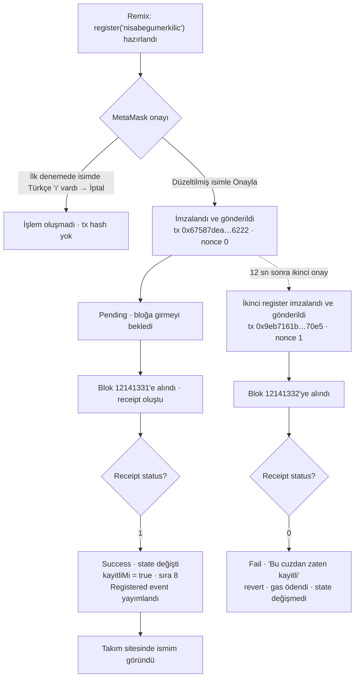

# İP 17: Explorer ile Kaydı Doğrula

**Amaç:** Gönderilen veri ile kayıt sonucunu ayrı kanıtlarla incelemek.

## 1. İsim kayıt işlemimin alanları

İşlem: [`0x67587deae063fe93b5678de80f6c66ce83a965fb3149ab8e794011afdfb06222`](https://sepolia.etherscan.io/tx/0x67587deae063fe93b5678de80f6c66ce83a965fb3149ab8e794011afdfb06222)

> Kaynak notu: 2., 3. ve 6. başlıklardaki Etherscan değerlerini yapay zekâ asistanı Etherscan sayfalarından okudu. Bu sayfaların ekran görüntüsünü almadım. 4. başlıktaki `tumKayitlar` okumasını Remix'te kendim yaptım.

## 2. Decode Input Data: gönderdiğim isim

Input Data'nın ilk 4 baytı `0xf2c298be`, `register(string)` fonksiyonunun seçicisi. Sonrası ABI kodlamasıyla dizilmiş parametre:

| Parça | Anlamı |
|---|---|
| `0xf2c298be` | çağrılan fonksiyon: `register(string name)` |
| `0000…0020` | metnin başladığı yer (32 bayt ileride) |
| `0000…0010` | metnin uzunluğu: 16 bayt |
| `6e697361626567756d65726b696c6963` | `nisabegumerkilic` (UTF-8) |

Etherscan'in "Decode Input Data" görünümü aynı veriyi `register(string name)` → `nisabegumerkilic` olarak gösteriyor. Input Data, **ne gönderdiğimi** kanıtlıyor.

## 3. Logs: Registered event'i

İşlemin Logs sekmesinde tek bir event var:

| Alan | Değer |
|---|---|
| Event | `Registered(address indexed uye, string isim, uint256 sira, uint256 zaman)` |
| topic0 | `0xf815c62c815721df19419e55df8335668299067048bb50a723cf723eed99871a` |
| uye (indexed) | `0x05d782Efca095aF3569D76Ef5542c352B3800Af6` |
| isim | `nisabegumerkilic` |
| sira | 8 |
| zaman | 1794759156 (15.11.2026 16:12:36 UTC) |

Event, sözleşmenin **ne yaptığını** kanıtlıyor: beni 8. üye olarak kaydetti. `uye` alanı indexed olduğu için Etherscan ve takım sitesi bu adrese göre arama yapabiliyor.

## 4. Read Contract: güncel state

Sözleşmenin `tumKayitlar` fonksiyonunu okuduğumda kendi satırımı gördüm: `0x05d782…00Af6, nisabegumerkilic, 8, 1794759156`. Bu değerler event'teki değerlerle birebir aynı. `kayitliMi(0x05d782…00Af6)` adresim için `true` döner. Bunun zincir üzerindeki kanıtı da var: aynı cüzdanla gönderilen ikinci register işlemi `require(!kayitliMi[msg.sender])` satırında "Bu cuzdan zaten kayitli" ile reddedildi (6. başlık). `kayitliMi` yalnızca true/false döndürür; ismi ve sırayı `tumKayitlar` gösterir.

## 5. Akış şeması: kendi işlemlerimle

İP 07'deki genel şema, benim iki register işlemime göre burada yeniden çizildi:

## 6. İkinci kayıt denemesi

İkinci deneme **zincirde** oluşan bir hatadır:

| Bilgi | Değer |
|---|---|
| Tx hash | [`0x9eb7161beb8d120af9434856ecd46984001572b81a244e2ef25ca315503670e5`](https://sepolia.etherscan.io/tx/0x9eb7161beb8d120af9434856ecd46984001572b81a244e2ef25ca315503670e5) |
| Blok / zaman | 12141332 · 15.11.2026 16:12:48 UTC |
| Status | Fail with error "Bu cuzdan zaten kayitli" |
| Nonce | 1 |
| Gas used / limit | 21,400 / 589,438 |
| Ücret | 0.0000000000003638 ETH |

Bunu "gönderilmemiş hata" ile karıştırmamak gerekiyor. Gönderilmemiş hatada cüzdan, işlemi gönderimden önce simüle eder (`eth_estimateGas`) ve uyarı verir; uyarı geçilmezse **tx hash, makbuz ve ücret oluşmaz**. Benim ikinci işlemim ise bloğa alındı, bir makbuzu var, status 0, nonce harcadı ve ücret ödedi. Yalnızca state değişmedi. İlk denemede MetaMask'te İptal ettiğim yanlış yazılmış isim ise gerçekten gönderilmemiş bir işlemdir; onun hiçbir izi yok.

## Benim yorumum

Bu üç kaynak bana üç ayrı soruya cevap verdi. **Input Data** "ne gönderdim?" sorusunu cevapladı: `register` fonksiyonunu `nisabegumerkilic` ismiyle çağırdım. **Event** "sözleşme bununla ne yaptı?" sorusunu cevapladı: beni 8. sırada, şu zamanda kaydetti. **State** ise "şu an durum ne?" sorusunu cevapladı: kayıtlıyım ve listede 8. satırdayım. İkinci başarısız işlemim farkı iyi gösterdi. Onun da bir Input Data'sı var, yani aynı ismi tekrar gönderdim. Ama hiç event'i yok ve state'i değiştirmedi. Yani bir işlemin gönderilmiş olması, yapılmış olması demek değil; bunu event ve state'e bakarak anlıyorum.

## Kaynaklar
- [Kayıt işlemi – Sepolia Etherscan](https://sepolia.etherscan.io/tx/0x67587deae063fe93b5678de80f6c66ce83a965fb3149ab8e794011afdfb06222)
- [İkinci (başarısız) kayıt işlemi – Sepolia Etherscan](https://sepolia.etherscan.io/tx/0x9eb7161beb8d120af9434856ecd46984001572b81a244e2ef25ca315503670e5)
- [Takım sözleşmesi – Sepolia Etherscan](https://sepolia.etherscan.io/address/0x81Dd700C459BF2806A1B5F2a349c89f0106A9036#code)
- [Solidity Docs – Contract ABI Specification](https://docs.soliditylang.org/en/latest/abi-spec.html)
- [ethereum.org – Transactions](https://ethereum.org/en/developers/docs/transactions/)
