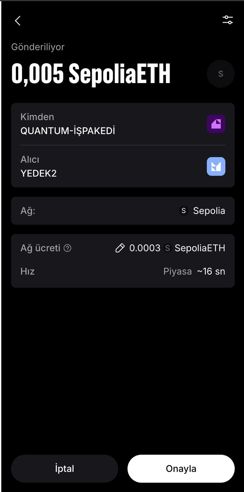
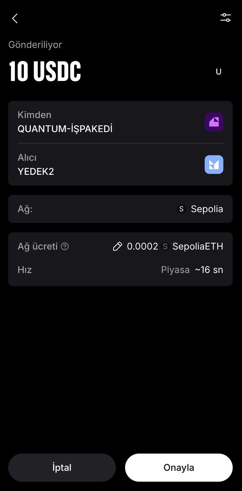
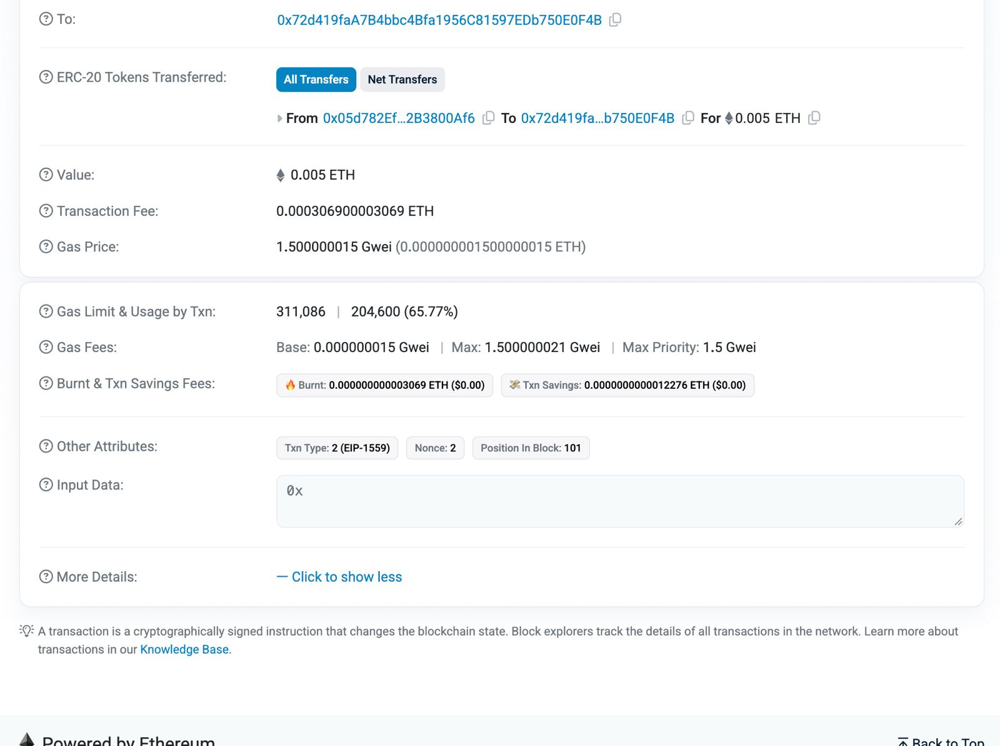
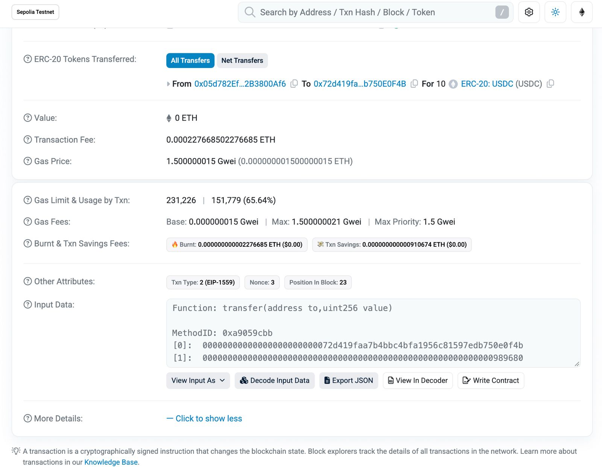
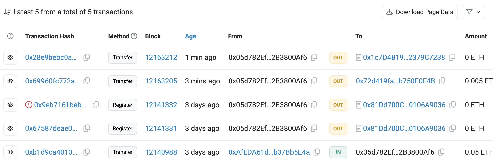

# İP 15: Test USDC Edin ve İki Transferi Karşılaştır

**Amaç:** Native varlık ile token farkını gözlemlemek.

## 1. Circle'ın resmî faucet'i, token sözleşme adresi ve MetaMask'te görünür yapmak

Ethereum Sepolia test USDC sözleşme adresini Circle'ın kendi dokümantasyonundaki "USDC contract addresses" tablosundan buldum: `0x1c7D4B196Cb0C7B01d743Fbc6116a902379C7238`. Aynı ada sahip sahte token sözleşmeleri olabileceği için adresi üçüncü taraf listelerden değil, projenin kendi alan adından aldım. Test USDC'yi Circle'ın faucet'inden (faucet.circle.com) yalnızca adresimi girerek aldım.

MetaMask'te Tokenlar → Token içe aktar → Özel token ile sözleşme adresini girdim; sembol USDC ve ondalık 6 kendiliğinden geldi. Bu işlem zincirde hiçbir şey değiştirmedi ve ücret ödemedim. MetaMask'e yalnızca "bu sözleşmedeki bakiyemi de oku" demiş oldum.

## 2. İkinci eğitim hesabı ve iki transfer

MetaMask'te "Hesap ekle" ile ikinci hesabı açtım: `0x72d419faA7B4bbc4Bfa1956C81597EDb750E0F4B`. Bu hesap aynı 12 kelimeden m/44'/60'/0'/0/1 yoluyla türüyor. İlk hesabımdan ona 0.005 ETH ve 10 USDC gönderdim; MetaMask'te bu hesabın adı "YEDEK2". İP 16 ve sonrası için ilk hesabımda ETH bıraktım.

## 3. İki işlemin karşılaştırması

| Alan | ETH işlemi | USDC işlemi |
|---|---|---|
| Tx hash | `0x69960fc772a8a513dfc8c14efb6b08c244275db6c830de91c323ed3a61604da9` | `0x28e9bebc0a1ee6d2a121cc62cea2822e6f66ff30b4ada397354b1b14370a0520` |
| Blok / zaman (UTC) | 12163205 · 18.11.2026 18:27:24 | 12163212 · 18.11.2026 18:28:48 |
| Status | Success | Success |
| To | `0x72d419fa…0F4B` (ikinci hesap) | `0x1c7D4B19…7238` (USDC sözleşmesi) |
| Value | 0.005 ETH | 0 ETH |
| Input Data | `0x` (boş) | `transfer(address to, uint256 value)`, MethodID `0xa9059cbb` |
| Alıcı | To alanında | Input Data `[0]`: `72d419fa…750e0f4b` |
| Miktar | Value alanında | Input Data `[1]`: `0x989680` = 10.000.000 birim = 10 USDC |
| Token transferi / log | — | Transfer event'i: From `0x05d7…00Af6` To `0x72d4…0F4B`, 10 USDC |
| Transaction Fee | 0.000306900003069 ETH | 0.000227668502276685 ETH |
| Gas limit / used | 311,086 / 204,600 | 231,226 / 151,779 |
| Nonce | 2 | 3 |

ETH transferinde protokol bakiyeleri doğrudan değiştirdi; işlem doğrudan ikinci hesaba gitti. USDC transferinde ise hiçbir şey adresler arasında "yürümedi". USDC bakiyeleri, USDC sözleşmesinin içindeki `adres → bakiye` tablosunda duruyor. Ben sözleşmenin `transfer` fonksiyonunu çağırdım, sözleşme kendi tablosunda benim satırımı azaltıp ikinci hesabın satırını artırdı. Bu yüzden USDC işleminde To alanında ikinci hesap değil sözleşme yazıyor, Value 0, alıcı ve miktar Input Data'da, sonuç ise Transfer event'inde. USDC 6 ondalıklı olduğu için zincirde 10 USDC, 10.000.000 olarak yazılıyor.

**Token'ı cüzdanda göstermek ile zincirde almak:** Zincirde almak, USDC sözleşmesinin tablosunda benim satırımın artmasıdır; bu faucet işlemiyle oldu. Cüzdanda göstermek ise MetaMask'in o tabloyu okumasıdır (`balanceOf`); bu token içe aktarınca oldu. İçe aktarmasaydım da USDC zincirde benimdi, sadece cüzdanda görünmüyordu.

Nonce'lar da hesabımın gönderdiği işlemleri sırayla gösteriyor: 0 başarılı register, 1 başarısız register, 2 ETH transferi, 3 USDC transferi.

Beklenmeyen bir gözlem: düz bir ETH transferi normalde 21.000 gas harcar, benimki 204.600 harcadı ve bu yüzden ETH işleminin ücreti USDC'ninkinden yüksek çıktı. Sebebini doğrulayamadım. Olası açıklama, MetaMask'in "akıllı hesap" (EIP-7702) özelliğinin hesaplardan birinde açık olması; bu durumda hesaba bağlı kod çalıştığı için gas artar.

## Benim yorumum

USDC gönderirken ücretin ETH bakiyemden çıktığını üç yerden gördüm. MetaMask'in onay penceresinde 10 USDC gönderirken "Ağ ücreti" USDC değil 0.0002 SepoliaETH olarak yazıyordu. Etherscan'de USDC işleminin Transaction Fee satırı ETH olarak görünüyordu. İşlemden sonra USDC bakiyem yalnızca gönderdiğim 10 kadar azaldı, ücret kadar azalan ise ETH bakiyemdi. Yani token ne olursa olsun gas her zaman native varlıkla ödeniyor. Bu da şu anlama geliyor: ETH'si olmayan bir hesap elinde USDC olsa bile onu gönderemez. İkinci hesaba yalnızca USDC değil biraz ETH de göndermemin sebebi buydu.

## Kaynaklar
- [Circle – USDC contract addresses](https://developers.circle.com/stablecoins/usdc-contract-addresses)
- [Circle Faucet](https://faucet.circle.com)
- [ethereum.org – ERC-20](https://ethereum.org/en/developers/docs/standards/tokens/erc-20/)
- [Solidity Docs – Contract ABI Specification](https://docs.soliditylang.org/en/latest/abi-spec.html)
- [EIP-1559 – Fee market](https://eips.ethereum.org/EIPS/eip-1559)
- [EIP-7702](https://eips.ethereum.org/EIPS/eip-7702)
