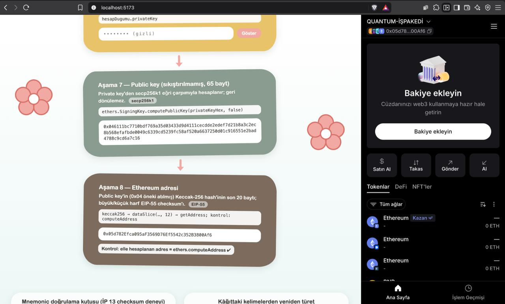
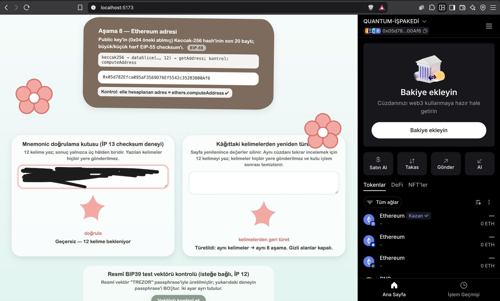

# İP 13: MetaMask ile Karşılaştır ve Checksum Deneyi Yap

**Amaç:** Üretilen hesabın uyumunu ve kelime doğrulamasını görmek.

## 1. 12 kelimeyi MetaMask'e aktarma

İlk denememde kelimeleri kişisel MetaMask'ime "Cüzdan ekle" ile eklemeye çalıştım. MetaMask yeni kelimelerde bile "Bu Gizli Kurtarma İfadesi zaten içe aktarıldı" hatası verdi ve eklenen hesabı listede bulamadım; kesin sebebini doğrulayamadım. O sırada bir eğitim cüzdanının kelimeleri ekran görüntüsüyle yapay zekâ sohbetine girdi; o cüzdanı bir daha kullanmadım ve yenisini ürettim.

Sonunda temiz yola geçtim: Brave'deki eski MetaMask eklentisini silip yeniden kurdum. Yeni üretilen kelimeleri kâğıda yazıp Safari'deki MetaMask'e ve bu temiz Brave eklentisine içe aktardım. Kelimeler kâğıtta duruyor. Hiçbir dosyaya ve depoya yazılmadı. Kanıt görsellerinde kelimeler ya hiç görünmüyor ya da kapatıldı.

Burada şunu gördüm: hesap adı, parola ve ağ listesi her kurulumda ayrı tutuluyor. Aynı kelimeleri iki farklı kuruluma girince hesap adı birinde "quantum-ispaket", diğerinde "Account 1" oldu, ama adres aynı kaldı.

## 2. İlk hesabın adresini uygulamanın adresiyle karşılaştırma

| | Adres |
|---|---|
| Uygulama (Aşama 8) | `0x05d782Efca095aF3569D76Ef5542c352B3800Af6` |
| MetaMask ilk hesap | `0x05d782Efca095aF3569D76Ef5542c352B3800Af6` |

İki adres aynı 20 baytı gösteriyor. EIP-55 büyük/küçük harf düzeni de birebir aynı çıktı. Eşleşmenin üç varsayımı tuttu: aynı yol (m/44'/60'/0'/0/0), aynı hesap indeksi (0) ve boş passphrase. Harfler farklı görünseydi bile 40 hex karakteri küçük harfe çevirip karşılaştırmak yeterli olurdu, çünkü EIP-55 adresi değiştirmez, yalnızca yazım hatalarını yakalar.

## 3. Checksum deneyi

Uygulamadaki doğrulama kutusu üç sonuç veriyor: "Geçerli (checksum tuttu)", "Geçersiz — kelime listede yok" ve "Geçersiz — checksum tutmadı". Önce kelime sayısına, sonra her kelimenin 2048'lik listede olup olmadığına, en son checksum'a bakıyor. Listede olmayan bir kelime checksum'a gelmeden reddediliyor.

Kâğıttaki kelimelerle kutu "Geçerli" dedi. Sonra bir kelimeyi listedeki başka kelimelerle değiştirerek birkaç deneme yaptım; denemelerimin hepsinde sonuç "Geçersiz" çıktı, tesadüfen geçen bir kelimeye denk gelmedim. Gerçek kelimelerim gizli olduğu için deneme ayrıntılarını (pozisyon ve kelime) kaydetmedim. Aynı davranış herkese açık resmî test kelimeleriyle (11 × `abandon` + `about`) de kontrol ediliyor. Aşağıdaki sonuçlar asistanın yazdığı otomatik testten (`cuzdan-araci/test/cuzdan.test.js`) geliyor ve her çalıştırmada yeniden kontrol ediliyor:

| Deneme (resmî test kelimeleri) | Değişiklik | Sonuç |
|---|---|---|
| 1 | değişiklik yok | Geçerli (checksum tuttu) |
| 2 | 12. kelime `about` → `abandon` (listede olan kelime) | Geçersiz — checksum tutmadı |
| 3 | 12. kelime `about` → `xyzxyz` (listede olmayan) | Geçersiz — kelime listede yok |
| 4 | yalnızca iki kelime | Geçersiz — 12 kelime bekleniyor |
| 5 | başta/sonda boşluk ve satır sonu ile yapıştırma | Geçerli (kopyala-yapıştır düzeltmesinden sonra) |

Kendi kelimelerimle yaptığım bir denemenin, kelimeleri kapatılmış ekran görüntüsü aşağıda; o denemede kutu kelime sayısında takıldı ("12 kelime bekleniyor").

Checksum yalnızca 4 bit olduğu için sınırlı hata yakalar. Bir kelimeyi değiştirince yeni entropinin checksum'ı 16 olası değerden birine düşer ve 12. kelimedeki eski checksum'la yaklaşık 1/16 ihtimalle tesadüfen tutar. O zaman kutu "Geçerli" der, ama bu kelimeler artık başka bir entropiye, başka bir seed'e ve başka bir hesaba aittir.

## 4. Değiştirilmiş mnemonic'i kullanmamak

Deneyde değiştirdiğim kelime setlerinin hiçbirini MetaMask'e aktarmadım. Sonraki bütün görevlerde yalnızca adresi doğrulanan `0x05d782…00Af6` hesabını kullandım.

## Benim yorumum

Geçerli mnemonic ile güvenli biçimde üretilmiş mnemonic aynı iddia değil. "Geçerli" yalnızca kelimelerin listede olduğunu ve 4 bitlik checksum'ın tuttuğunu söylüyor; deneyde gördüğüm gibi yanlış bir kelime de 16'da 1 ihtimalle geçerli çıkabilir. Güvenli üretim ise entropinin tahmin edilemez bir kaynaktan gelmesiyle ilgili, yani benim uygulamamda Aşama 1 ile. Biri Math.random ile ya da kafasından 12 kelime seçip checksum'ı uydursa kutu yine "Geçerli" derdi ama o cüzdan güvenli olmazdı. Kelimelerimin bir kez sohbete girmesi de bunu gösterdi: kelimeler hâlâ geçerliydi ama artık güvenli değildi, o yüzden cüzdanı bıraktım.

## Kaynaklar
- [BIP-39](https://github.com/bitcoin/bips/blob/master/bip-0039.mediawiki) – Checksum ve kelime listesi
- [EIP-55](https://eips.ethereum.org/EIPS/eip-55)
- [MetaMask Destek – Gizli Kurtarma İfadesi](https://support.metamask.io/configure/wallet/how-to-recover-your-secret-recovery-phrase/)
