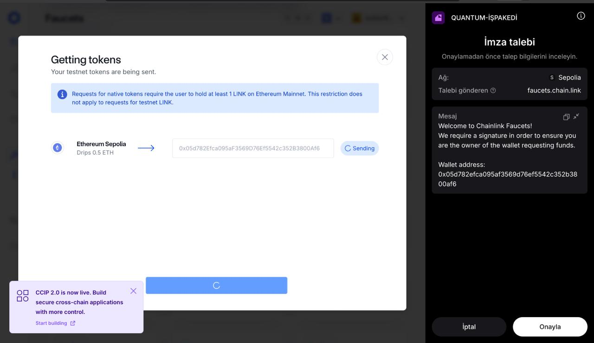
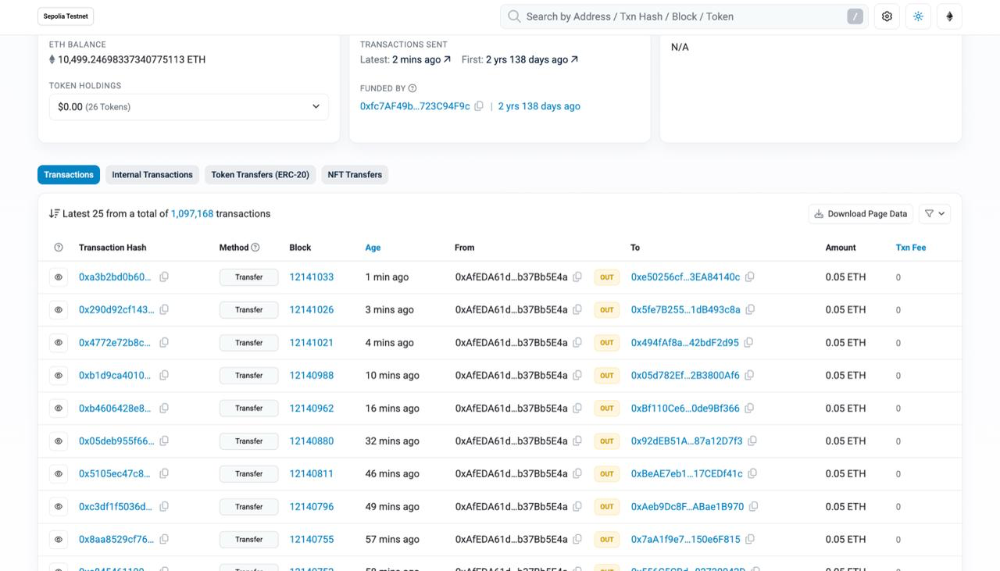
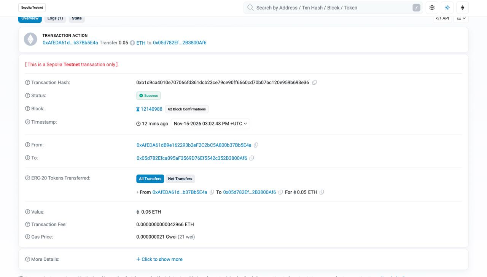
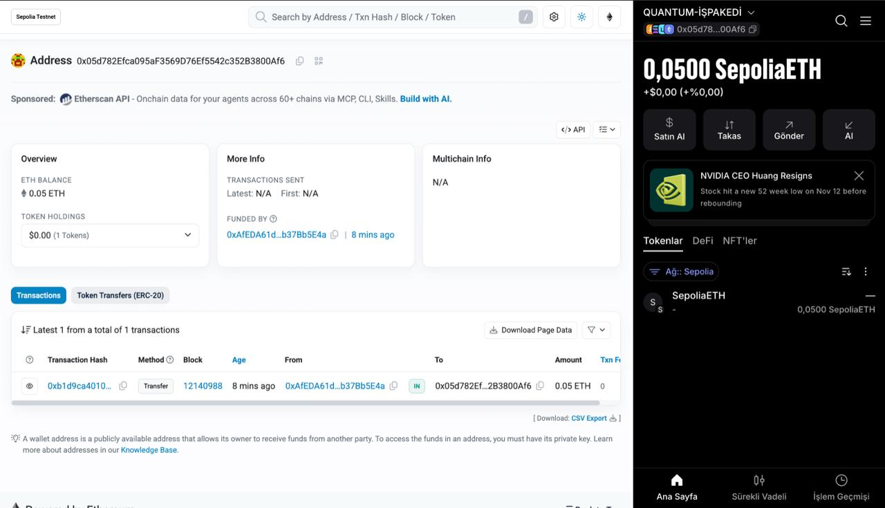

# İP 14: Test ETH Kaynağını Kendin Bul

**Amaç:** Faucet araştırmak ve test hesabını kullanıma hazırlamak.

## 1. Doğrulanan hesabı MetaMask'te Sepolia'da açmak

İP 13'te doğruladığım `0x05d782…00Af6` hesabını MetaMask'te açıp ağ olarak Sepolia'yı seçtim. Adres değişmedi, çünkü adres private key'den türer, ağdan değil. Ağ seçmek aslında cüzdanın hangi zincire, yani hangi RPC adresine soracağını seçmektir. Sepolia'nın chain ID'si 11155111 ve bu numara imzaya girdiği için Sepolia işlemi ana ağda geçersizdir.

## 2. Resmî bir Sepolia faucet'i bulmak ve koşullarını doğrulamak

Chainlink'in resmî faucet'ini (faucets.chain.link) kullandım. Alan adının Chainlink'e ait olduğunu adres çubuğundan kontrol ettim. Faucet yalnızca adresimi ve sahibi olduğumu kanıtlamam için bir mesaj imzası istedi. Mesaj düz metindi ("Welcome to Chainlink Faucets… Wallet address: 0x05d7…"), token harcama izni içermiyordu ve ağ Sepolia'ydı. Mesaj imzalamak işlem göndermek değildir: gas ödenmez, zincire yazılmaz. Hiçbir siteye kelime veya private key girmedim, test varlığı satın almadım.

Ekranda "Drips 0.5 ETH" yazmasına rağmen zincire 0.05 ETH geldi. Faucet ekranında ayrıca ana ağda LINK bulundurma şartından bahseden bir uyarı vardı, ama gönderim gerçekleşti.

## 3. Gelen işlemi cüzdanda ve Sepolia Etherscan'de bulmak

MetaMask'te bakiyem 0,05 SepoliaETH oldu ama İşlem Geçmişi'nde gelen işlem görünmedi, çünkü işlemi ben değil faucet imzaladı. İşlemi `sepolia.etherscan.io`'da adresimi arayarak buldum. Explorer'a public key değil, adres girilir.

| Alan | Değer | Anlamı |
|---|---|---|
| Transaction Hash | `0xb1d9ca4010e707066fd361dcb23ce79ce90ff6660cd70b07bc120e959b693e36` | İmzalı işlemin Keccak-256 hash'i; imza anında oluşur, tek başına başarı kanıtı değildir |
| Status | Success | Makbuzdaki status 1; asıl başarı kanıtı |
| Block | 12140988 | İşlemin girdiği blok |
| Timestamp | 15 Kasım 2026, 15:02:48 UTC | İşlemin girdiği bloğun üretildiği zaman; imza anı değil |
| From | `0xAfEDA61dB9e162293b2eF2C2bC5A800b37Bb5E4a` | Faucet'in cüzdanı |
| To | `0x05d782Efca095aF3569D76Ef5542c352B3800Af6` | Benim adresim |
| Value | 0.05 ETH | Native varlık transferi |
| Transaction Fee | 0.0000000000042966 ETH | Gas used × gas price; faucet ödedi |

Faucet'in adres sayfasına bakınca 1 milyondan fazla işlem göndermiş ve dakikada bir 0,05 ETH dağıtan sıradan bir cüzdan olduğunu gördüm. Adres sayfasındaki bakiye güncel state'i, işlem listesi ise değişmeyen geçmişi gösteriyor.

## 4. PoW faucet

PoW faucet kullanmadım. Kullansaydım tarayıcıda yapılan hesaplama, faucet'in botları caydırmak için koyduğu kendi dağıtım koşulu olurdu. Bu hesaplama zincire yazılmaz ve Sepolia'da blok üretmekle aynı şey değildir; Sepolia PoS ile çalışır, blokları validatörler üretir.

## Benim yorumum

Bu görevde adresimi bir faucet sitesine, Etherscan'e ve bir yapay zekâ sohbetine verdim; hiçbiri hesabımdan tek bir wei gönderemedi. Faucet bana ETH gönderebildi çünkü kendi private key'iyle kendi hesabından imza attı. Adres, İP 12'de Aşama 8'de gördüğüm gibi public key'in hash'inin son 20 baytı; ondan geriye, yani private key'e gidilemiyor. Harcama yetkisi imzada, imza da private key'de. Adresi paylaşmak bir posta adresi vermek gibi: herkes kutuya bir şey bırakabilir ama kutuyu ancak anahtarı olan açabilir. Yine de adresin herkese açık olduğunu da gördüm: adresimi bilen herkes Etherscan'de bakiyemi ve bütün işlemlerimi görebiliyor.

## Kaynaklar
- [ethereum.org – Networks (Sepolia)](https://ethereum.org/en/developers/docs/networks/)
- [Chainlink Faucets](https://faucets.chain.link)
- [Sepolia Etherscan](https://sepolia.etherscan.io)
- [ethereum.org – Transactions](https://ethereum.org/en/developers/docs/transactions/)
- [EIP-155 – Chain ID](https://eips.ethereum.org/EIPS/eip-155)
